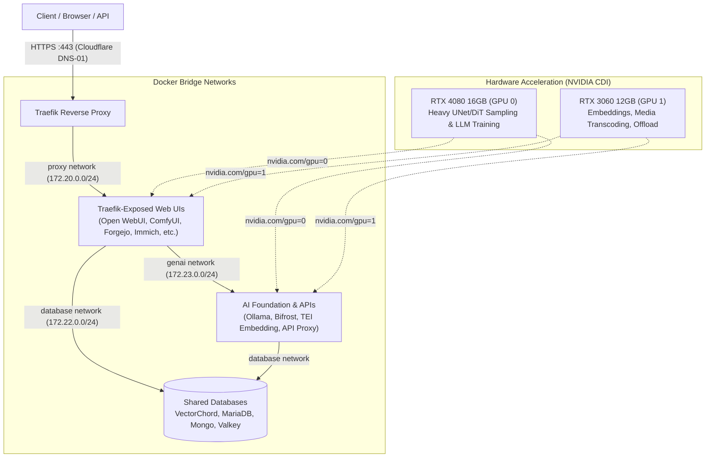

# Homelab Compose

A modular Docker Compose homelab for local generative AI, databases, media streaming, infrastructure, and management tools. Each application is an independent Compose project with its own configuration and persistent data. Deployed with rootless Docker, systemd service lifecycle management via `composectl`, NVIDIA CDI for dual-GPU allocation, and Traefik for automated HTTPS routing.

The repository describes available projects; a directory's presence does not imply the service is currently running or enabled at boot.

---

## Architecture Overview



---

## Repository Index & Projects

Projects are organized by category under `category/service`. All 29 services are cataloged below in alphabetical order by category:

### AI & Machine Learning (`ai/`)
[AI services guide](ai/README.md)

| Service | Path | Description | Integration |
| :--- | :--- | :--- | :--- |
| **AI Toolkit** | [`ai/toolkit`](ai/toolkit/README.md) | Ostris LoRA trainer for Krea 2, Qwen Image 2.1, and diffusion models | GPU 0 for training, GPU 1 for captioning; UI at `toolkit.${TRAEFIK_ACME_DOMAIN}` |
| **Bifrost** | [`ai/bifrost`](ai/bifrost/) | Unified AI proxy gateway across local and remote model providers | Upstream for Open WebUI; uses VectorChord (PostgreSQL) and Valkey |
| **ComfyUI** | [`ai/comfyui`](ai/comfyui/README.md) | Node-based generative AI workflow engine (`comfyui-app`) + API v2 proxy (`comfyui-proxy`) | Dual GPUs visible via CDI; Linux DLSS5 via Proton; loopback ports 8188 and 8189; Traefik UI |
| **Embedding** | [`ai/embedding`](ai/embedding/) | Text embedding and reranking microservice for RAG pipelines | TEI embedder, reranker, and proxy on GPU 1; used by Open WebUI |
| **Forge Neo** | [`ai/forgeneo`](ai/forgeneo/README.md) | Stable Diffusion WebUI Forge for fast image generation | Shares ComfyUI assets read-only; dedicated to GPU 0 |
| **Hollama** | [`ai/hollama`](ai/hollama/README.md) | Lightweight browser-side client for local LLM APIs | Connects directly to Ollama API from the browser |
| **KoboldCpp** | [`ai/koboldcpp`](ai/koboldcpp/) | GGUF LLM inference with built-in browser UI and generation APIs | On-demand inference on GPU 0; bind-mounts model storage |
| **Ollama** | [`ai/ollama`](ai/ollama/) | Downloads and serves quantized local language models | Exposes both GPUs via CDI; internal API on `genai` network |
| **Open WebUI** | [`ai/openwebui`](ai/openwebui/) | Full-featured chat interface for local and remote models | Integrates Bifrost, TEI embeddings, PostgreSQL, and CPU task inference sidecar |
| **RisuAI** | [`ai/risuai`](ai/risuai/) | Character-based LLM chat and roleplaying client | Traefik web route; persistent storage |
| **SmartGallery** | [`ai/comfyui-gallery`](ai/comfyui-gallery/) | Visual gallery and workflow browser for ComfyUI outputs | Shares ComfyUI output, input, and model directories |
| **Strata** | [`ai/strata`](ai/strata/README.md) | High-throughput Qwen3.8-Flash-Next inference engine | Dual-GPU layer split (RTX 4080 + RTX 3060) with CPU offloading; custom Bake build |
| **Text Generation WebUI** | [`ai/textgen`](ai/textgen/) | Multi-backend LLM loading and interactive generation interface | On-demand GPU 0 workload with persistent user data and cache |

### Databases (`db/`)
[Databases guide](db/README.md)

| Service | Path | Description | Integration |
| :--- | :--- | :--- | :--- |
| **MariaDB** | [`db/mariadb`](db/mariadb/) | MySQL-compatible relational database | Backing database for PhotoPrism; file-backed secrets |
| **MongoDB** | [`db/mongo`](db/mongo/) | Document-oriented database | Document store for compatible applications; internal privilege dropping |
| **Valkey** | [`db/valkey`](db/valkey/) | High-speed Redis-compatible in-memory cache and key-value store | Caching layer for Bifrost and Immich |
| **VectorChord / PostgreSQL** | [`db/vchord`](db/vchord/) | Relational database with vector search, BM25, and tokenizer extensions | Central database backing Bifrost, Forgejo, Immich, and Open WebUI |

### Infrastructure & Reverse Proxy (`infra/`)
[Infrastructure guide](infra/README.md)

| Service | Path | Description | Integration |
| :--- | :--- | :--- | :--- |
| **Forgejo** | [`infra/forgejo`](infra/forgejo/) | Self-hosted Git forge and collaboration platform | Web at `git.${TRAEFIK_ACME_DOMAIN}`; SSH on host port 222; uses VectorChord |
| **Infisical** | [`infra/infisical`](infra/infisical/) | Centralized secrets management and distribution platform | Web at `infisical.${TRAEFIK_ACME_DOMAIN}`; host port 8080 |
| **Traefik** | [`infra/traefik`](infra/traefik/) | Reverse proxy, ACME TLS certificate manager, and container router | Host ports 80/443; Cloudflare DNS-01 challenges; dashboard at `traefik.${TRAEFIK_ACME_DOMAIN}` |

### Media Services (`media/`)
[Media services guide](media/README.md)

| Service | Path | Description | Integration |
| :--- | :--- | :--- | :--- |
| **Immich** | [`media/immich`](media/immich/) | Self-hosted photo and video backup platform | CUDA-accelerated machine learning on GPU 1; uses VectorChord and Valkey |
| **Jellyfin** | [`media/jellyfin`](media/jellyfin/) | Media streaming server | Hardware NVENC/NVDEC transcoding on GPU 1; LAN ports 8096 and 7359 |
| **Lychee** | [`media/lychee`](media/lychee/) | Manga, comic, and image gallery reader | Traefik web route; secret-file key management; connects to library storage |
| **PhotoPrism** | [`media/photoprism`](media/photoprism/) | AI-powered photo indexing and organization | MariaDB storage; read-only media library mounts; GPU 1 acceleration |
| **Plex + Tautulli** | [`media/plex`](media/plex/) | Video streaming server and monitoring analytics | NVDEC/NVENC hardware transcoding on GPU 1; direct media discovery ports |
| **Stash** | [`media/stash`](media/stash/) | Adult media catalog and organization platform | Hardware-accelerated image on GPU 1; persistent metadata and previews |

### Management Panels (`panel/`)
[Panels guide](panel/README.md)

| Service | Path | Description | Integration |
| :--- | :--- | :--- | :--- |
| **Homepage** | [`panel/homepage`](panel/homepage/) | Homelab application dashboard | Auto-discovers `homepage.*` labels; live status widgets; `home.${TRAEFIK_ACME_DOMAIN}` |
| **Portainer** | [`panel/portainer`](panel/portainer/) | Web-based container management UI | Direct Docker socket integration; `panel.${TRAEFIK_ACME_DOMAIN}` |
| **Tugtainer** | [`panel/tugtainer`](panel/tugtainer/) | Container image update tracker | Tracks image digests and alerts on updates; `updates.${TRAEFIK_ACME_DOMAIN}` |

### Shared Libraries (`lib/`)
[Shared helpers guide](lib/README.md)

- [`lib/secret-env.sh`](lib/secret-env.sh) — POSIX entrypoint shim bind-mounted into containers requiring `/run/secrets/` file translation to uppercase environment variables with recursive `$VAR` variable expansion.

---

## Directory Layout

```text
compose/
├── ai/                     # AI/ML services (toolkit, bifrost, comfyui, comfyui-gallery, embedding, forgeneo, hollama, koboldcpp, ollama, openwebui, risuai, strata, textgen)
├── db/                     # Databases (mariadb, mongo, valkey, vchord)
├── infra/                  # Infrastructure (forgejo, infisical, traefik)
├── media/                  # Media streaming & photo libraries (immich, jellyfin, lychee, photoprism, plex, stash)
├── panel/                  # Dashboards and management (homepage, portainer, tugtainer)
├── lib/                    # Shared container entrypoint scripts (secret-env.sh)
├── service.toml            # Systemd inter-service dependency graph
└── AGENTS.md               # Architecture standards and agent instructions
```

---

## Orchestration with `compose-utils`

[compose-utils](https://github.com/delfianto/compose-utils) provides two complementary personas from a single Rust binary:

- **`compose`**: Thin project-level wrapper for direct Docker Compose operations (`compose ps`, `compose pull`, `compose up`).
- **`composectl`**: Systemd-integrated lifecycle manager that handles startup, updates, dependencies, and boot persistence (`composectl start <service>`, `composectl update <service>`, `composectl deps`).

### Why `composectl`?

Every service in this repository declares `restart: "no"`. Systemd (`compose@.service`) owns container lifecycle, restart-on-failure, and inter-service dependencies.

```bash
# Manage services from anywhere on the host
composectl status ai-comfyui --json
composectl start ai-comfyui
composectl update ai-comfyui
composectl restart ai-comfyui
composectl enable ai-comfyui
```

### Systemd Dependency Mapping

Compose `depends_on` only coordinates containers *within* a single Compose project. Cross-project dependencies (e.g. `ai-openwebui` needing `db-vchord` and `ai-bifrost`) are enforced by systemd drop-in units managed via `composectl deps` and documented in [`service.toml`](service.toml):

```toml
[ai-bifrost]
requires = ["db-vchord", "db-valkey"]

[ai-openwebui]
requires = ["db-vchord", "ai-bifrost", "ai-embedding"]
wants = ["ai-ollama"]

[infra-forgejo]
requires = ["db-vchord"]

[media-immich]
requires = ["db-vchord", "db-valkey"]
```

---

## Configuration Layering & Secrets

| Layer | Path | Purpose | Tracked in Git? |
| :--- | :--- | :--- | :--- |
| **Machine-wide config** | `~/.config/docker/compose.env` | Host-wide defaults: `COMPOSE_BASE`, `COMPOSE_DATA`, ACME settings, Docker socket | No |
| **Project defaults** | `<service>/.env` | Interpolation variables: image tags, paths, GPU IDs | Yes |
| **Project overrides** | `<service>/.env.local` | Local interpolation overrides (evaluated last) | No (`.gitignore`) |
| **Container runtime** | `<service>/<service>.env` | Application runtime environment variables | Yes |
| **Container secrets** | `<service>/<service>.env.local` | Local runtime secrets (when referenced via `env_file`) | No (`.gitignore`) |
| **Central Secret Store** | `/srv/appdata/secret/` | File-backed credentials mounted as Docker secrets (`mode 0600`) | No |

**Interpolation Precedence**: `~/.config/docker/compose.env` < `.env` < `.env.local`.

### Secret Management Pattern

Passwords and API keys must never be committed to git. Secrets are stored centrally in `/srv/appdata/secret/` (`SECRET_DIR`, owned by host `geist:geist` mode `0700`, files mode `0600`) and mounted via Compose secrets:

```yaml
secrets:
  my_secret:
    file: ${SECRET_DIR}/my_secret
```

Containers that do not natively read `/run/secrets/` mount [`lib/secret-env.sh`](lib/secret-env.sh) as `/secret-env.sh:ro` and set `entrypoint: ["/secret-env.sh"]`.

---

## Networks & Reverse Proxy

Five isolated Docker bridge networks are defined in `~/.config/docker/networks.toml` and declared as `external: true`:

| Network | Subnet | Internal | Purpose |
| :--- | :--- | :--- | :--- |
| `proxy` | `172.20.0.0/24` | No | Inbound Traefik routing and external outbound internet access |
| `metrics` | `172.21.0.0/24` | Yes | Prometheus and monitoring telemetry |
| `database` | `172.22.0.0/24` | Yes | Database-to-application traffic (VectorChord, MariaDB, Mongo, Valkey) |
| `genai` | `172.23.0.0/24` | Yes | Inter-service AI inference APIs and sidecars |
| `auth` | `172.24.0.0/24` | Yes | Centralized authentication connectivity |

Traefik terminates TLS at port 443 with Cloudflare DNS-01 ACME certificates and routes to internal services over `proxy` using container labels:

```yaml
labels:
  - "traefik.enable=true"
  - "traefik.docker.network=proxy"
  - "traefik.http.routers.app.rule=Host(`app.${TRAEFIK_ACME_DOMAIN}`)"
  - "traefik.http.routers.app.entrypoints=websecure"
  - "traefik.http.routers.app.tls.certresolver=cloudflare"
  - "traefik.http.services.app.loadbalancer.server.port=8080"
```

---

## Hardware & Dual-GPU Allocation

The host features dual NVIDIA GPUs managed through Container Device Interface (CDI) declarations:

- **GPU 0** (`nvidia.com/gpu=0`): NVIDIA GeForce RTX 4080 (16 GB VRAM). Primary compute for heavy UNet/DiT sampling (ComfyUI), LoRA training (AI Toolkit), and text generation (Forge Neo, KoboldCpp, Textgen).
- **GPU 1** (`nvidia.com/gpu=1`): NVIDIA GeForce RTX 3060 (12 GB VRAM). Pinned via `GPU_ID=1` in service `.env` files for embeddings (TEI), media transcoding (Immich ML, Jellyfin, PhotoPrism, Plex, Stash), and ComfyUI VAE/CLIP offloading.
- **Shared Access**: CDI device assignment grants container visibility, not exclusive locks. VRAM budgeting is managed cooperatively across services.

---

## Rootless Docker User Mapping

All services run on a rootless Docker daemon under user `geist` (host UID 1000):

- **UID `0:0` inside container**: Maps directly to host UID `1000:1000` (`geist:geist`). Bind mounts owned by `geist` on the host are writable without permission errors when containers run as `user: "0:0"`.
- **Non-zero UID inside container**: Maps into subordinate UIDs (container UID `1000` maps to host UID `100999`).
- **Privilege Dropping**: Containers drop all Linux capabilities (`cap_drop: - ALL`) and enforce `no-new-privileges: true`.

---

## Custom Builds & Publishing

Standalone repositories handle container builds and automatically publish images to GitHub Container Registry (GHCR):

- **ComfyUI & API Proxy**: Built in [delfianto/comfyui-docker](https://github.com/delfianto/comfyui-docker) (CUDA 13.4.2, Python 3.14, Linux DLSS5 via Proton, and Comfy API v2 proxy).
- **Forge Neo SD WebUI**: Built in [delfianto/sd-webui-forge-docker](https://github.com/delfianto/sd-webui-forge-docker) (CUDA 13.2, Python 3.13).
- **Zen5-optimized CPU Inference**: Open WebUI sidecar container built in its dedicated repository.

Images are pulled from `ghcr.io/delfianto/` during standard `composectl update` cycles.

---

## Disclaimer

This project comes without warranty of any kind. Use at your own risk:

- The Borg may invade your neighborhood.
- Your dog may suddenly hate you.
- Coffee may taste slightly more bitter.
- Spontaneous interpretive dance outbreaks are possible.
- The universe may collapse into a potato.

---

## License

[MIT License](LICENSE)
