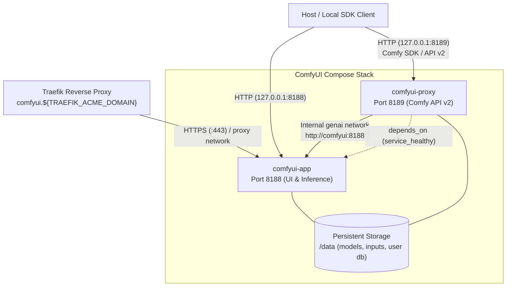

# ComfyUI Docker Compose Deployment

Docker Compose orchestration for a production ComfyUI generative AI service stack. Features automated dual-service architecture (main UI/compute engine + official API v2 proxy sidecar), dual-NVIDIA GPU CDI passthrough, Linux DLSS5 acceleration via Proton, and Traefik reverse proxy integration.

Container images are built and continuously published from the dedicated [comfyui-docker](https://github.com/delfianto/comfyui-docker) repository.

---

## Architecture & Services

The Compose stack runs two complementary containers connected over the internal `genai` network and Traefik's `proxy` network:

| Container | Image | Port | Description |
| :--- | :--- | :--- | :--- |
| `comfyui-app` | `ghcr.io/delfianto/comfyui-app:latest` | `127.0.0.1:8188`<br>`comfyui.${TRAEFIK_ACME_DOMAIN}` | Core ComfyUI web UI and node inference engine running Python 3.14 on CUDA 13.4.2 (PyTorch 2.11). Dual-GPU CDI access (`gpu=0` and `gpu=1`). |
| `comfyui-proxy` | `ghcr.io/delfianto/comfyui-proxy:latest` | `127.0.0.1:8189` | Official Comfy API v2 proxy sidecar (`comfy-api-proxy`). Handles v2 job queues, model downloads, and SDK communication without cloud egress. |



---

## Service Lifecycle (`composectl`)

In this homelab, systemd owns container lifecycle via `composectl` (services declare `restart: "no"`):

```bash
# Start ComfyUI stack
composectl start ai-comfyui

# Check status and health
composectl status ai-comfyui --json
compose ps

# Pull newest GHCR images and restart
composectl update ai-comfyui

# Restart the service
composectl restart ai-comfyui

# Stop the service
composectl stop ai-comfyui
```

---

## Official Local API Proxy & SDK Integration

The `comfyui-proxy` sidecar exposes the **Comfy API v2** surface at `http://127.0.0.1:8189`. It sits upstream of `comfyui-app` on the internal network (`http://comfyui:8188`) and shares the model and storage mounts (`/data`) for atomic model placement, input asset uploads, and proxy database persistence (`/data/user/proxy`).

Port `8189` is bound exclusively to host loopback (`127.0.0.1:8189`), giving local automation tools and scripts full API v2 contract compliance without relying on external cloud routing.

### Python SDK (`comfy-sdk`)

```python
from comfy_sdk import Comfy

# Connect directly to the local proxy
client = Comfy(base_url="http://127.0.0.1:8189")

# Inspect jobs, upload inputs, and trigger workflows
jobs = client.jobs.list()
print(f"Active jobs: {len(jobs.jobs)}")
```

### Smoke Test

A verification script is provided in the `comfyui-docker` repository:

```bash
uv run --with comfy-sdk python <path-to-comfyui-docker>/smoke-test-proxy.py
```

---

## Data Paths & Volume Layout

All valuable and persistent data lives outside the container under `${DATA_DIR}` and `${OUTPUT_DIR}`:

| Host Path | Container Mount | Purpose |
| :--- | :--- | :--- |
| `${DATA_DIR}/models` | `/data/models` | Checkpoints, LoRAs, VAEs, GGUFs, ControlNet weights, DLSS5 DLLs |
| `${DATA_DIR}/custom_nodes` | `/data/custom_nodes` | Persistent custom node Git checkouts |
| `${DATA_DIR}/input` | `/data/input` | Input images, audio, and reference assets |
| `${DATA_DIR}/user` | `/data/user` | SQLite database (`comfyui.db`), user settings, LoRA metadata, proxy storage |
| `${OUTPUT_DIR}` | `/data/output` | Generated renders |
| `${DATA_DIR}/cache/uv` | `/var/cache/uv` | Persistent cache for `uv pip` custom node dependencies |
| `${DATA_DIR}/cache/torch` | `/var/cache/torch` | PyTorch hub model cache |
| `${DATA_DIR}/cache/huggingface` | `/var/cache/huggingface` | Hugging Face model cache |
| `${DATA_DIR}/cache/dlss5` | `/var/cache/dlss5` | Wine prefix and machine ID for Linux DLSS5 |
| `tmpfs` | `/data/temp` | 8 GB high-speed memory scratch directory |

### Custom Node Dependency Management

Custom nodes survive container recreation because they live in `${DATA_DIR}/custom_nodes`. When `COMFYUI_INSTALL_CUSTOM_NODE_REQUIREMENTS=true` is set:

1. The entrypoint hashes declared `requirements.txt` across all custom nodes.
2. If dependencies changed, `uv pip` synchronizes packages into `/opt/venv` using the persistent cache at `/var/cache/uv`.
3. Startup resumes in seconds once dependencies are satisfied.

---

## Hardware & Dual-GPU Allocation

Both GPUs are declared via Compose CDI device syntax:

```yaml
devices:
  - nvidia.com/gpu=0
  - nvidia.com/gpu=1
```

- **GPU 0 (`nvidia.com/gpu=0`)**: NVIDIA GeForce RTX 4080 (16 GB VRAM). Primary compute device for UNet, DiT, and diffusion sampling.
- **GPU 1 (`nvidia.com/gpu=1`)**: NVIDIA GeForce RTX 3060 (12 GB VRAM). Secondary device for CLIP text encoding, VAE decode, or DisTorch2 offloading.
- **Cross-GPU Workflows**: Since consumer GPUs lack NVLink/P2P transfer, cross-GPU model communication routes via host PCIe memory. Preconfigured workflows are available in `${DATA_DIR}/user/default/workflows`.

---

## Linux DLSS5 Runtime (Proton Bridge)

The runtime image includes 32-bit bootstrap libraries, Xvfb, and Vulkan tools to support community DLSS upscaling under Linux:

- CachyOS Proton SLR is bind-mounted read-only at `/opt/proton`.
- Wine prefix and persistent machine ID reside under `${DATA_DIR}/cache/dlss5`.
- DLSS runtime libraries live in `${DATA_DIR}/models/dlss5`.
- For initial Wineprefix setup or after Proton upgrades, run `init-dlss-prefix.sh` from the [comfyui-docker](https://github.com/delfianto/comfyui-docker) repository:
  ```bash
  docker cp <path-to-comfyui-docker>/init-dlss-prefix.sh comfyui-app:/tmp/init-dlss-prefix.sh
  docker exec comfyui-app bash /tmp/init-dlss-prefix.sh
  ```

---

## Configuration Reference (`.env`)

Environment variables defined in `.env`:

```env
# Runtime images (from ghcr.io/delfianto)
IMAGE_NAME=ghcr.io/delfianto/comfyui-app
IMAGE_TAG=latest
IMAGE_PROXY_NAME=ghcr.io/delfianto/comfyui-proxy
IMAGE_PROXY_TAG=latest

# ComfyUI runtime configuration
COMFYUI_REPOSITORY=https://github.com/Comfy-Org/ComfyUI.git
COMFYUI_AUTO_UPDATE=false
COMFYUI_UPDATE_STRICT=false
COMFYUI_INSTALL_CUSTOM_NODE_REQUIREMENTS=true

# Persistent paths
DATA_DIR=/path/to/appdata/comfyui
OUTPUT_DIR=/path/to/output

# API proxy loopback port
PROXY_PORT=8189
```

---

## Container Security & Rootless Docker

- **Rootless User Namespace**: Containers run as container uid `0:0`, which safely maps to the unprivileged host user (e.g. UID 1000) under rootless Docker.
- **Privilege Dropping**: All Linux capabilities are dropped (`cap_drop: - ALL`) and `no-new-privileges: true` is enforced on both services.
- **Read-Only Rootfs**: The `comfyui-proxy` container runs with a read-only root filesystem (`read_only: true`), mounting isolated `tmpfs` at `/tmp`.
